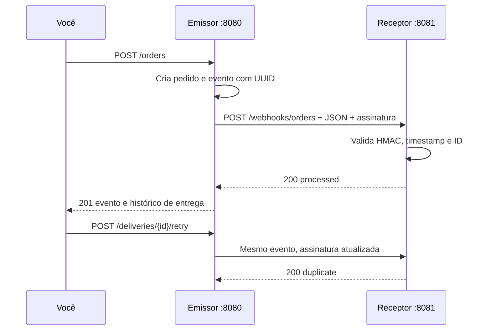

# Laboratório de webhooks — Java 25 e Spring Boot 4

Dois projetos Spring Boot independentes, agrupados em um reactor Maven para facilitar a compilação. O domínio de exemplo é a criação de pedidos.

| Projeto | Porta | Responsabilidade |
| --- | --- | --- |
| `webhook-emissor` | 8080 | Cria pedidos, publica eventos e registra tentativas de entrega |
| `webhook-receptor` | 8081 | Valida a assinatura e registra cada evento uma única vez |

## Como a comunicação acontece



Um webhook é uma requisição HTTP iniciada pelo sistema que produz o evento. O receptor oferece uma URL previamente configurada; o emissor envia o evento quando algo acontece. Aqui o destino é fixo na configuração. Não existe polling ou cadastro dinâmico de assinantes.

## Executar

Pré-requisitos: JDK 25 e Maven 3.6.3 ou superior. A versão fixada é Spring Boot **4.0.10**, compatível com Java 25 segundo a [documentação oficial](https://docs.spring.io/spring-boot/4.0/system-requirements.html).

Na raiz, compile e execute os testes:

```powershell
mvn clean verify
```

Abra dois terminais na raiz do laboratório. Primeiro, inicie o receptor:

```powershell
java -jar .\webhook-receptor\target\webhook-receptor-1.0.0.jar
```

No segundo terminal, inicie o emissor:

```powershell
java -jar .\webhook-emissor\target\webhook-emissor-1.0.0.jar
```

Também é possível executar cada projeto com `mvn -f webhook-receptor/pom.xml spring-boot:run` e `mvn -f webhook-emissor/pom.xml spring-boot:run`.

Em um terceiro terminal, rode o roteiro automatizado:

```powershell
.\scripts\estudar.ps1
```

Se a política local do PowerShell bloquear arquivos `.ps1`, execute em um processo separado (sem alterar a política permanente):

```powershell
powershell -NoProfile -ExecutionPolicy Bypass -File .\scripts\estudar.ps1
```

O roteiro cria um pedido, verifica a entrega e reenvia o evento para observar a deduplicação. Os logs de ambas as aplicações mostram o mesmo ID de evento para acompanhar a comunicação.

## Explorar manualmente

```powershell
$body = @{ customer = 'Maria'; total = 89.90 } | ConvertTo-Json
$entrega = Invoke-RestMethod http://localhost:8080/orders -Method Post -ContentType 'application/json' -Body $body
$entrega | ConvertTo-Json -Depth 10

# Histórico do emissor e eventos recebidos
Invoke-RestMethod http://localhost:8080/deliveries | ConvertTo-Json -Depth 10
Invoke-RestMethod http://localhost:8081/events | ConvertTo-Json -Depth 10

# O receptor retorna duplicate e mantém um único registro para esse ID
Invoke-RestMethod "http://localhost:8080/deliveries/$($entrega.event.id)/retry" -Method Post | ConvertTo-Json -Depth 10
```

O retorno de criação contém `event` e `attempts`. Cada tentativa registra horário, status HTTP e corpo retornado pelo receptor. Um `httpStatus` nulo significa falha de transporte. O HTTP 201 de `/orders` indica que o pedido foi criado; confira a tentativa para saber se o webhook foi entregue.

| Endpoint | Aplicação | Resultado |
| --- | --- | --- |
| `POST /orders` | Emissor | Cria pedido e tenta enviar `order.created` |
| `GET /deliveries` | Emissor | Lista eventos e tentativas |
| `POST /deliveries/{eventId}/retry` | Emissor | Reenvia o mesmo evento |
| `POST /webhooks/orders` | Receptor | Recebe JSON assinado |
| `GET /events` | Receptor | Lista eventos processados |

### Experimento: receptor indisponível

1. Pare o receptor com Ctrl+C.
2. Crie outro pedido. O emissor registra a falha de transporte e preserva o evento em memória.
3. Inicie o receptor novamente.
4. Reenvie pelo ID retornado em `event.id`. A nova tentativa deve retornar `processed`.

### Experimento: segredo incorreto

Pare o receptor e inicie com outro segredo no terminal dele:

```powershell
$env:WEBHOOK_SECRET = 'outro-segredo'
java -jar .\webhook-receptor\target\webhook-receptor-1.0.0.jar
```

Crie um pedido pelo emissor. A tentativa deve registrar HTTP 401. Para restaurar o padrão, pare o receptor, execute `Remove-Item Env:WEBHOOK_SECRET` e inicie novamente.

## Payload e assinatura

```json
{
  "id": "cfa8bff5-bbc5-4f85-99f6-25c0bccbeaad",
  "type": "order.created",
  "occurredAt": "2026-11-24T12:00:00Z",
  "data": {
    "id": "f27eab2d-2bc7-48e9-adbc-be2d3560ec51",
    "customer": "Ana",
    "total": 149.90
  }
}
```

O emissor calcula HMAC-SHA256 de `timestamp + "." + corpo JSON exato`, em UTF-8, com o segredo compartilhado. Envia os cabeçalhos `X-Webhook-Timestamp` (segundos Unix) e `X-Webhook-Signature` (`sha256=` seguido do hexadecimal). O receptor valida a assinatura antes de interpretar o JSON e aceita timestamps em uma janela de cinco minutos. Alterar o corpo invalida a assinatura. HMAC autentica a mensagem; HTTPS é necessário para proteger o tráfego fora do ambiente local.

O ID identifica o evento e permanece igual nos reenvios. A assinatura usa um timestamp novo em cada tentativa. O receptor usa uma inserção atômica por ID para que reenvios concorrentes não criem registros duplicados. Eventos repetidos recebem 200 com `duplicate`, permitindo ao emissor encerrar a entrega com sucesso.

## Configuração e limites do laboratório

| Variável | Aplicação | Padrão |
| --- | --- | --- |
| `WEBHOOK_SECRET` | Ambas | `segredo-local-apenas-para-estudo` |
| `WEBHOOK_URL` | Emissor | `http://localhost:8081/webhooks/orders` |
| `SERVER_PORT` | Ambas | 8080 / 8081 |

Para usar um segredo próprio, defina o mesmo `WEBHOOK_SECRET` nos dois terminais antes de iniciar as aplicações.

Os dados ficam em memória e desaparecem ao reiniciar. O emissor espera a resposta do receptor na própria requisição de criação, com timeout de conexão de dois segundos e de requisição de cinco segundos. O reenvio é manual, sem fila ou retentativas automáticas. O processamento de negócio do receptor é representado pelo registro do evento recebido.

Em uma evolução para produção, estude outbox transacional, armazenamento persistente de entregas e deduplicação, fila com backoff e limite de tentativas, autenticação dos endpoints administrativos e retenção do histórico. A janela de timestamp reduz replays antigos; a deduplicação cobre reenvios dentro dela enquanto a aplicação mantém seu estado.
